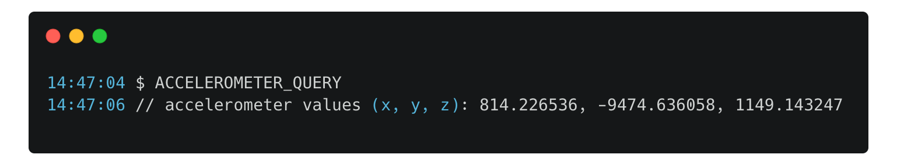
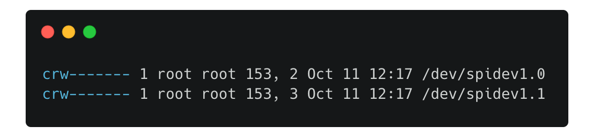
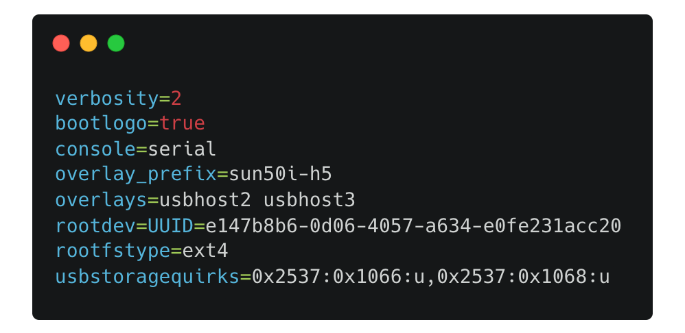
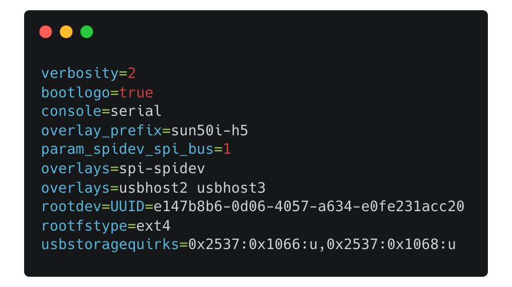
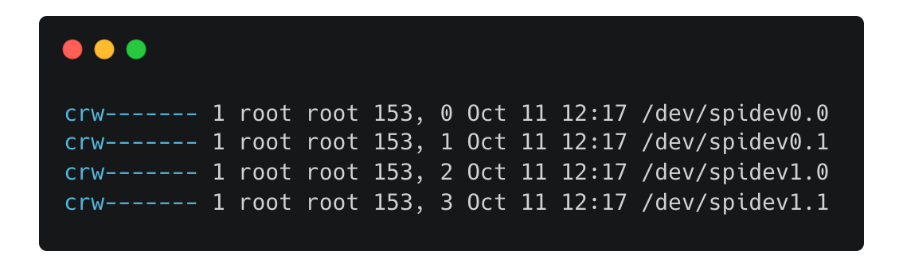

# Voron 0.2 Fly Gemini V3 Setup Guide

A hopefully handy guide to flash the FLY Gemini V3 in a Voron V0 with Fluidd and Klipper.

## Contents

- [Installation](#installation)
  - [Re-Flashing The Printer](#re-flashing-the-printer)
  - [Add Wifi](#add-wifi)
  - [Mainsail Fix](#mainsail-fix)
  - [V0 Display](#v0-display)
- [Updating](#updating)
- [Extras](#extras)
  - [ADXL via SPI](#adxl-via-spi)
  - [Camera](#camera)

---

## Installation

### Re-Flashing The Printer


1\. Format an SD card (16-32gb) via Disk Management in Windows


2\. Get Raspberry Pi image tool https://www.raspberrypi.com/software/


3\. Download and unpack the FLYOS image 7zip from above `FLY-v3.1_Flygemini_bullseye_0819_5.10.85.img.7z`
This came from [Mellow](https://mellow.klipper.cn/#/introduction/downloadimg)


> (version in screenshot works with Gemini V3 board)

4a. Write this img file to the sd card via the Pi Image Tool, you don't need to add any wifi details etc yet.

4b. Insert the sd card into the Gemini

5\. Plug board into computer via the bottom left USB C port, and open Device Manager and expand Ports (COM & LPT), you should see a new COM port appear


6\. Get PuTTY https://www.putty.org/ and set it up with your COM port like so


> Give it a few seconds, You're in

6b\. If you're using a macOS (or unix based system) you don't need any additional program. You can use built-in command `screen`

Type below command in terminal to find the correct device.

`ls /dev/tty* | grep usbserial`

You should get something like

`crw-rw-rw-  1 root             wheel   0x9000006 Oct  7 22:47 /dev/tty.usbserial-xxxxx`

Then you just need to connect to the device using

`screen /dev/tty.usbserial-xxxxx 115200`

### Add Wifi

7\. Type nmtui into putty and press enter
Use the arrow keys to navigate and enter for OK


7b. Select Activate a connection

7c. Navigate to your wifi id, press enter, then type your password, and press enter again
Your window should look like so:


7d. Press esc esc to back out of this menu

7e. Type ip a and press enter
Look for an ip similar to 192.168.1.85, copy this into your browser and you should see Fluidd


Errors shown will be fixed during this document

Ok, let's switch user and connect via wifi. Open a new putty instance, you can close the old window.

8\. Input the new details for the board


Once in the console, username 'fly' password 'mellow'


9a. Cd klipper, make clean, make menuconfig


9b. Set the options like so


Press q then y to save and quit

9c. Type `make -j4`


10a. Remove diagonal jumper before the next step, we're going to flash the MCU (the right portion of the Gemini)


10b. Type the following into Putty

`wget -O gemini-tools_install.sh https://cdn.mellow.klipper.cn/Utils/gemini-tools/gemini-tools_install.sh && sudo bash gemini-tools_install.sh gemini-v3-tools`

Type password when required

10c. If you get hid-flash error type
`cd ~/klipper/lib/hidflash && make`

Else type
`sudo gemini-v3-tools -f ~/klipper/out/klipper.bin`

10d. Type the following commands
`sudo gemini-v3-tools -h`

> this enters burning mode

`sudo gemini-v3-tools -s`

> this starts MCU normally

`sudo gemini-v3-tools -r`

> This resets the MCU

`ls /dev/serial/by-id/*`

10e. Grab the blue text like below

`/dev/serial/by-id/usb-Klipper_stm32f405xx........`

and put it in your printer.cfg


### Mainsail Fix

To fix the below, change the path to the virtual directory in mainsail, I did this by navigating to the config locations and editing them using Nano. There are easier ways of doing this, but this is how I did it.


```
cd mainsail-config
nano mainsail.cfg
```


Scroll using arrow keys, change virtual sdcard to expected location
CTRL+X to save, press Y, then enter


Do the same with ~/printer-data/mainsail/mainsail.cfg

Do the same with printer.cfg but via Fluidd (because easier)


### V0 Display

Somewhat stolen from https://github.com/VoronDesign/Voron-Hardware/blob/master/V0_Display/Documentation/Setup_and_Flashing_Guide.md to have a version of documentation that won't change

If your display is attached to the printer, turn it onto its side so you can see the underside of the display

1\. Install the boot jumper and press the reset button on the back of the display board. This will put the board into DFU mode.


2\. Run `lsusb` from the command prompt

Make sure you see an STM32 in DFU mode listed

3\. Run `dfu-util --list` from the command prompt, and it should say one DFU is available, make a note of the text inside the [xxxx:yyyy]

4\. Run `cd ~/klipper` from the command line to enter the Klipper directory

5\. Run `make menuconfig`

settings should be:


> Pay attention to the PA9/PA10 comm setting, as if you get it wrong it won't work and show up in blue

Set the "Optional features" to:


Hit Q to Exit and Save

6\. Run make clean to clean up the make environment.

7\. Run make flash FLASH_DEVICE=xxxx:yyyy (using xxxx:yyyy from above)

> You may see what appears to be an "error" after flashing your board. (Blue box)
> As long as you see the File downloaded successfully text (Green box) you are good to proceed.

> The error (Red box) seems to be caused by the controller immediately running the uploaded code and no longer appearing as a DFU device. This is not an issue, as long as the board reports a Klipper serial name. If you see an issue with space on the chip, it may be that you still have an item ticked on the optional features step.


8\. Remove the boot jumper and press the reset button on the back of the display.

After completion `ls /dev/serial/by-id/*` should return a device beginning with `/dev/serial/by-id/usb-Klipper_stm32f042x6...`

---

## Updating

### Updating the Printer

1\. Back up all your cfg files somewhere just in case


2\. Recover any that require recovery

Note: fluidd-config might not want to recover - This should fix itself later


3\. Reboot host - This is to make sure the repos and installs are all in a safe state to update


4\. Update OS Packages - this will take SEVERAL minutes

5\. Update Moonraker - also takes several minutes, Moonraker will then restart, give it a few minutes to settle.

6\. Update Fluidd

7\. Update Mainsail

8\. Update Crowsnest

RESTART the host again

8\. Update klipper

RESTART the host again

If fluidd-config is still showing Invalid / Recover - click on another menu tab, or the home screen, then come back to the update screen.
Then if it still doesn't show, wait about half an hour and do the same, Speculation below:

Speculation:
Every 30 minutes the Gemini backs up files, hence the reason if you don't shut down the machine correctly you can lose up to 30 minutes of changes.
I believe fluidd-config may update from the backup at that time.

This may explain being unable to update it, after many attempts at updating it in the UI and within the linux console it seemed fixed itself once I went to the home screen, then returned to the updates panel.

I think my explanation is correct but without more testing or communication from the developer of the fluidd/mainsail install, I couldn't say for sure.

I hope your updates page looks like this:


---

## Extras

### ADXL via SPI

In some cases the ADXL via SPI won't work out of the box. We'll fix that :)

1\. First let's configure the adxl in config files. Edit `printer.cfg` and add the following:

```
[adxl345]
cs_pin: host:None

[resonance_tester]
accel_chip: adxl345
probe_points: 60, 60, 20
```

2\. Run `ACCELEROMETER_QUERY` in the fluidd/mainsail console to check if everything's working. The correct output looks like this:



If you're getting any errors, try running the command again as soon as possible after getting an error.
If the problem persists there's a set of things that we can do.

3\. Let's check what SPI addresses are available by running `ls -la /dev/spi*`



4\. Update the `[adxl345]` config part by adding the `spi_bus: spidevX.X` according to the list you get from previous step and rerun `ACCELEROMETER_QUERY` command again:

> **Replace the X.X with number you got from the `ls` command**

```
[adxl345]
cs_pin: host:None
spi_bus: spidev1.0 # or spidev1.1
```

If you're still getting errors we need to edit the host OS file `/boot/armbianEnv.txt` and add spi-spidev overlay.

> For some strange reason using `armbian-config` doesn't seems to work. (You can try, though)

5\. Edit the armbianEnv file by running

```
nano /boot/armbianEnv.txt
```

The file should look similar to like the one below.



We need to add two things just below the line that starts with phrase `overlays`

```
param_spidev_spi_bus=1
overlays=spi-spidev
```

The final file should look like this



> Why I didn't put the file for you to copy? Because it can vary from board to board, so it's better to just add the lines in correct place.

6\. Redo the point 3 - you should get additional spi devices on the list



7\. Redo the point 4. If everything went ok, you should be able to successfully check accelerometer status (look point 2)

### Camera

Look in crowsnest logs for something like video0 / video1
Change your `crowsnest.conf` to match the camera that has been detected as a camera

API key location in Fluidd for Cura/Octoprint connection

